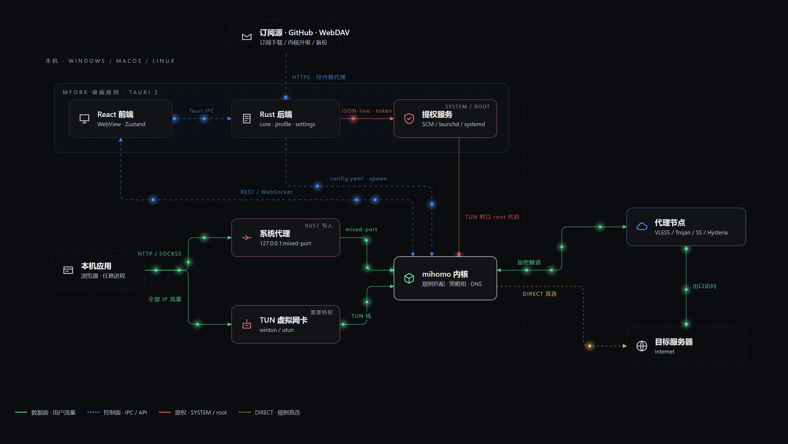

# Mfork

一個基於 [mihomo](https://github.com/MetaCubeX/mihomo) 內核的桌面代理客戶端。Tauri 2 + React 19 構建，支持 Windows / macOS / Linux（三平台均含系統代理與 TUN 提權服務；Windows 已實機驗證，macOS / Linux 為交叉編譯檢查通過、待實機驗證）。

> 設計文檔見 [docs/DESIGN.md](docs/DESIGN.md)，UI 設計稿源文件在 [design/](design/)。

## 架構與數據包流向

[](docs/diagrams/mfork-architecture.html)

上圖為靜態截圖；交互版在 [docs/diagrams/mfork-architecture.html](docs/diagrams/mfork-architecture.html)（單文件、離線可開）：數據包沿鏈路實時流動，可按數據面 / 控制面 / 提權 / 直連篩選，懸停節點查看說明，「追蹤一個數據包」從應用到目標逐步點亮，支持深淺主題。節點與連線在文件內的 `nodes` / `edges` 兩張表中維護，路徑與動畫由其生成。

- **數據面（綠）**：本機應用 → 系統代理（HTTP/SOCKS5）或 TUN 虛擬網卡 → mihomo 內核 → 加密隧道到代理節點 → 目標；命中 `DIRECT` 規則則從內核直連（琥珀色點線）
- **控制面（藍虛線）**：React 前端經 Tauri IPC 調 Rust 後端；Rust 生成 `config.yaml` 並 spawn 內核；運行時請求與四路事件訂閱統一經 Tauri IPC → Rust；Linux/macOS 使用私有 Unix socket 連接 mihomo，Windows/Android 由 Rust 連接 loopback controller；訂閱、內核升級、備份等出站請求經內核代理
- **提權（紅）**：TUN 需要特權時由提權服務（Windows SCM / macOS launchd / Linux systemd）以 SYSTEM / root 代啟內核，GUI 全程不提權

## 開發

前置要求：Node.js ≥ 20、pnpm、Rust stable（Windows 為 MSVC 工具鏈；Linux 另需 webkit2gtk 等，見 `.github/workflows/build.yml`）。

```bash
# 1. 安裝依賴
pnpm install

# 2. 下載當前平台的 mihomo 內核（僅首次；自動識別 OS/架構）
node scripts/fetch-core.mjs

# 3. 構建提權服務（TUN 需要；Windows/macOS/Linux 同一腳本）
node scripts/build-service.mjs

# 4. 啟動開發環境
pnpm tauri dev
```

打安裝包：`pnpm tauri build`（內核隨包分發，用戶無需單獨下載）。本機打包需提供 updater 簽名私鑰，且**必須同時設置密碼變量**（即使私鑰無密碼，否則 CLI 會停在密碼提示）：

```bash
TAURI_SIGNING_PRIVATE_KEY="$(cat ~/.tauri/mfork.key)" TAURI_SIGNING_PRIVATE_KEY_PASSWORD="" pnpm tauri build
```
推送 `v*` tag 或手動觸發 GitHub Actions 可產出 Windows/macOS(x64+arm64)/Linux 全平台安裝包。

### Android（實驗中，見 `docs/ANDROID.md`）

同一份 React 界面與 Rust 業務邏輯，加 Kotlin 側 VpnService（開發中）。目前的 APK：界面完整、內核在手機上以子進程運行、經 Wi-Fi 手動代理使用；VPN 一鍵接管尚未完成。

```bash
# 需要 JDK 17、Android SDK（platforms 35/36、build-tools 35）、NDK r27，並 export JAVA_HOME / ANDROID_HOME / NDK_HOME
node scripts/fetch-core.mjs --android arm64      # 放置 gen/android/.../jniLibs/arm64-v8a/libmihomo.so
pnpm tauri android build --debug --apk --target aarch64
# 產物：src-tauri/gen/android/app/build/outputs/apk/
```

### macOS 簽名與公證

CI 在以下 GitHub secrets 存在時自動對 .app/.dmg 簽名並公證，缺省則產出未簽名包（首次打開需右鍵「打開」或 `xattr -cr Mfork.app`）：

| Secret | 內容 |
|---|---|
| `APPLE_CERTIFICATE` | Developer ID Application 證書 .p12 的 base64 |
| `APPLE_CERTIFICATE_PASSWORD` | .p12 密碼 |
| `APPLE_SIGNING_IDENTITY` | 如 `Developer ID Application: Name (TEAMID)` |
| `APPLE_ID` / `APPLE_PASSWORD` / `APPLE_TEAM_ID` | 公證用 Apple ID、app-specific password、Team ID |

應用內更新另需 `TAURI_SIGNING_PRIVATE_KEY`（與 `TAURI_SIGNING_PRIVATE_KEY_PASSWORD`，無密碼時設為空）。

## 當前進度

- [x] M1 骨架與內核閉環：Tauri 腳手架、內核啟停守護、REST API 連通、概覽頁（實時流量/內存/連接數、模式切換）；全部頁面骨架（代理/連接/規則/日誌接真實 API）；連接監控雙視圖（socket 級逐條連接 + 應用級按進程聚合，`find-process-mode: always`）
- [x] M2 訂閱系統：訂閱下載（UA clash.meta、subscription-userinfo 流量頭）、增刪改/更新/切換、本地文件導入、按訂閱設定的定時自動更新；覆寫系統（YAML 深合併含 prepend-/append- 語義 + 內嵌 JS 引擎跑 `main(config)` 變換，Monaco 編輯器，保存即熱重載）；配置生成管線（訂閱 → 覆寫鏈 → GUI 托管字段 → config.yaml → PUT /configs 熱重載）
- [x] M3 代理頁與系統集成：策略組/節點測速、排序/隱藏不可用；系統代理（註冊表 + 繞過列表）、托盤菜單、開機自啟、靜默啟動、單實例
- [x] M4 監控：連接頁（socket / 應用雙視圖、搜索、TCP/UDP 與活躍過濾、按出站過濾、各列排序、來源/目標端點與展開的五元組詳情、斷開）、日誌頁（等級過濾、暫停）、規則頁（規則集 provider 手動更新）；概覽頁節點地球（大陸剪影出血裁切、僅標可連接節點、通路以浮在球面上方的弧線繪製並帶流光；鏈式代理沿 `dialer-proxy` 完整展開每一跳，活動連接的其他通路同時顯示；可拖拽旋轉、鬆手自動回位；位置由節點名稱地區提示推斷）、模式行內建 TUN 開關；無系統標題欄（Windows 自繪窗口按鈕，macOS 沿用原生紅黃綠燈）
- [x] M5 TUN 與提權服務：特權服務代啟內核（Windows SCM 服務 / macOS launchd daemon / Linux systemd 單元，安裝時一次系統授權）、TUN 參數（協議棧/嚴格路由/DNS 劫持）、DNS 接管（fake-ip / 上游）
- [x] M6 打磨：內核自升級（stable / alpha 通道，經內核代理下載）、GeoData 更新、固定端口 / 局域網 / IPv6、主題（深 / 淺 / 跟隨系統）、多語言（简体 / 繁體 / English，含托盤）、備份（本地 zip + WebDAV 備份/恢復）、應用自動更新（tauri-updater + GitHub Releases）

實機測試清單見 [docs/TESTING-M5.md](docs/TESTING-M5.md) 與 [docs/TESTING-M6.md](docs/TESTING-M6.md)。

## 發佈與自動更新

- 推送 `v*` tag 觸發 CI（`tauri-apps/tauri-action`）：全平台打包、簽名 updater 產物並建立 GitHub Release **草稿**（含 `latest.json`），手動 publish 後應用內「檢查更新」即可看到。
- 倉庫 Secrets 需設置 `TAURI_SIGNING_PRIVATE_KEY`（本機 `~/.tauri/mfork.key` 的內容；公鑰已寫在 `src-tauri/tauri.conf.json`）。私鑰丟失則之後的版本無法被舊版本驗證，務必備份。
- 更新源 endpoint 在 `tauri.conf.json → plugins.updater.endpoints`，目前指向 GitHub `secret-deus/Mfork`，換倉庫時同步修改。

## 架構速覽

- **Rust（src-tauri）**：`core` 進程守護、`controller` 本機 API 與事件傳輸（Unix socket / 原生 loopback）、`profile` 訂閱與配置生成、`override_` 覆寫管線、`system` 系統代理/自啟、`tray` 托盤、`service` 提權服務客戶端、`updater` 內核自升級、`backup` 本地/WebDAV 備份、`settings` 應用設置
- **i18n（src/i18n）**：源語言 zh-CN，源字串即 key（`t("啟動內核")`），`en.ts` / `zh-TW.ts` 為字典；新增 UI 文字後補齊兩份字典即可
- **主題（src/index.css + src/theme.ts）**：調色板以 CSS 變量掛在 `<html data-theme>`，Tailwind token 經 `@theme inline` 映射；組件只用 token 類名，不寫硬編碼色值
- **前端（src）**：運行時數據通過 Tauri commands / channels 交給 Rust，不在 WebView 內發起 controller HTTP / WebSocket 請求
